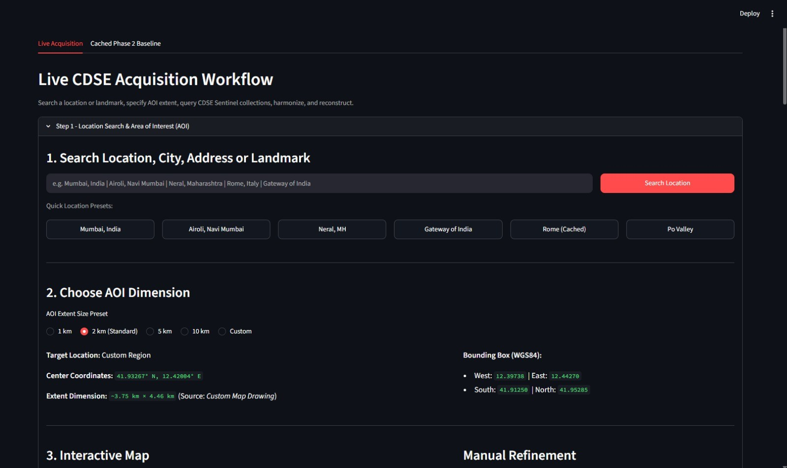
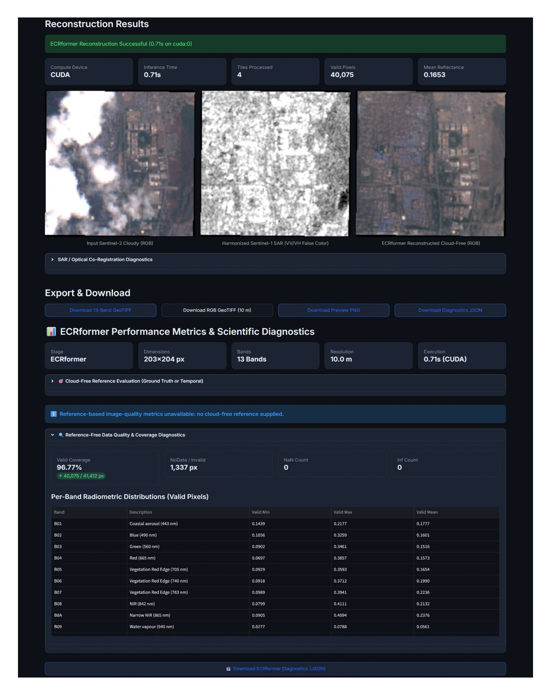
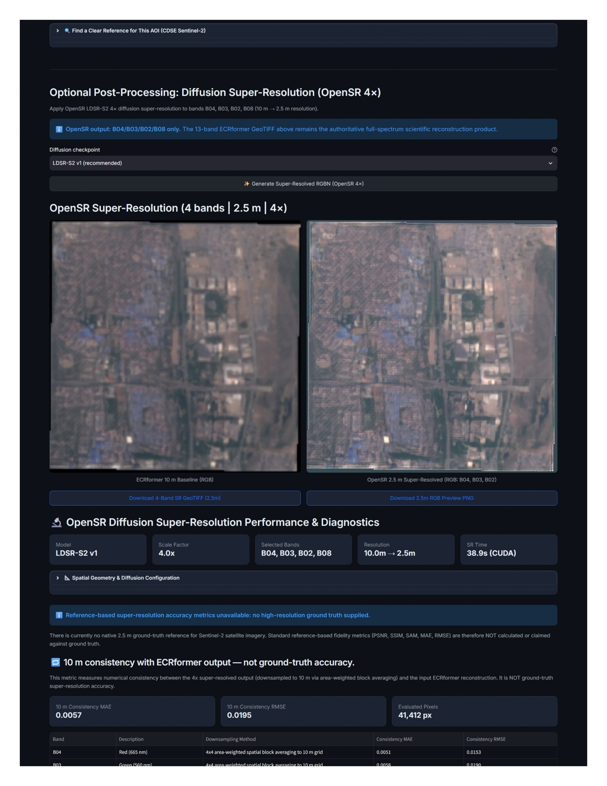

# CloudVision AI

### Sentinel-2 Cloud Reconstruction with ECRformer and Diffusion-Based Super-Resolution

An end-to-end satellite image processing pipeline for acquiring, harmonizing, reconstructing, and optionally super-resolving Sentinel-2 satellite imagery.

The system combines:

- Sentinel-1 SAR and Sentinel-2 optical imagery
- Spatial harmonization and common-grid processing
- ECRformer for 13-band cloud reconstruction
- OpenSR LDSR-S2 diffusion for optional 4× super-resolution
- CDSE-based satellite data acquisition
- Interactive Streamlit visualization and processing
- Automated validation and integration tests

---

## 1. Overview

Cloud cover can make optical satellite imagery unusable for remote-sensing applications.

This project addresses the problem through a two-stage pipeline:

1. **Cloud Removal / Reconstruction**
   - Uses Sentinel-1 SAR and cloudy Sentinel-2 imagery.
   - ECRformer reconstructs a cloud-free **13-band Sentinel-2 image**.
   - Output resolution: **10 m**.

2. **Optional Super-Resolution**
   - Uses OpenSR LDSR-S2 diffusion on selected Sentinel-2 bands.
   - Processes B04 (Red), B03 (Green), B02 (Blue), and B08 (NIR).
   - Produces a **4-band 4× super-resolved product**.
   - Output resolution: **2.5 m-equivalent**.

The complete workflow is exposed through an interactive Streamlit application.

CloudVision AI integrates pretrained ECRformer weights for cloud reconstruction and an optional LDSR-S2/OpenSR stage for super-resolution. The reports also review CNN, GAN, Transformer, diffusion, SAR-optical, and multi-temporal methods; those comparisons provide research context and do not mean every reviewed method is implemented in this application.

## Screenshots

The screenshots below show the application workflow. Quantitative reconstruction metrics require a suitable clear reference; the displayed runs explicitly indicate when one was not supplied.

### Live satellite acquisition



### ECRformer cloud reconstruction



### Optional OpenSR super-resolution



---

## 2. System Architecture

```text
                   Sentinel-1 SAR
                        │
                   Sentinel-2
                  Cloudy Optical
                        │
                        ▼
              ┌──────────────────┐
              │ Spatial          │
              │ Harmonization    │
              └────────┬─────────┘
                       │
                       ▼
              ┌──────────────────┐
              │    ECRformer     │
              │ Cloud Removal    │
              └────────┬─────────┘
                       │
                       ▼
        13-Band Cloud-Free Sentinel-2
                  10 m Resolution
                       │
             ┌─────────┴──────────┐
             │                    │
             ▼                    ▼
     Scientific Product       Optional OpenSR
       13-band TIFF               │
                                  ▼
                      Select B04/B03/B02/B08
                                  │
                                  ▼
                       OpenSR LDSR-S2 Diffusion
                                  │
                                  ▼
                            4× Super-Resolution
                                  │
                                  ▼
                      4-Band RGB-NIR Product
                         2.5 m-equivalent
                                  │
                     ┌────────────┴────────────┐
                     ▼                         ▼
                RGB Preview                 SR GeoTIFF
              B04 + B03 + B02             B04/B03/B02/B08
```

The 13-band ECRformer reconstruction remains the authoritative full-spectrum scientific product. The OpenSR stage is optional and does not overwrite it.

---

## 3. Main Components

### 3.1 Satellite Data Acquisition

The live workflow supports:

- Location-based AOI selection
- Copernicus Data Space Ecosystem (CDSE) search
- Sentinel-1 acquisition
- Sentinel-2 acquisition
- Cached acquisition workflows
- Uploaded/custom imagery

Workflow:

```text
Location
   ↓
AOI
   ↓
CDSE Search
   ↓
Sentinel-1 / Sentinel-2 Acquisition
   ↓
Harmonization
   ↓
ECRformer
```

### 3.2 Spatial Harmonization

Before model inference, Sentinel-1 and Sentinel-2 products are aligned to a common spatial grid.

The harmonization stage handles:

- CRS transformation
- Common grid generation
- Spatial alignment
- 10 m target grid
- Resampling
- Validity masking
- GeoTIFF metadata preservation

---

## 4. ECRformer Cloud Reconstruction

ECRformer is the primary cloud-removal model in the pipeline.

The application runs ECRformer with pretrained weights. This repository integrates its inference workflow; it does not claim that the model was trained from scratch here.

### Inputs

```text
Sentinel-1 SAR
+
Cloudy Sentinel-2
```

### Output

```text
13-band reconstructed Sentinel-2
10 m resolution
```

Example verified output:

```text
204 × 204 pixels
13 bands
10 m
EPSG:32643
float32
```

Band order:

```text
B01, B02, B03, B04, B05, B06, B07,
B08, B8A, B09, B10, B11, B12
```

---

## 5. OpenSR Diffusion Super-Resolution

OpenSR is an **optional post-processing stage** after ECRformer.

The current OpenSR model is **not a 13-band diffusion model**. It operates on four selected Sentinel-2 bands:

| Band | Role |
|---|---|
| B04 | Red |
| B03 | Green |
| B02 | Blue |
| B08 | NIR |

Processing flow:

```text
13-band ECRformer output
        │
        ▼
Select B04/B03/B02/B08
        │
        ▼
OpenSR LDSR-S2 Diffusion
        │
        ▼
4× Super-Resolution
        │
        ▼
4-band RGB-NIR output
```

The original 13-band ECRformer GeoTIFF is preserved and is never overwritten.

The application offers two inference choices. **LDSR-S2 v1** is the canonical recommended checkpoint and remains the default. **LDSR-S2 v2 preview** is an experimental option that uses the upstream DPM-Solver++ sampler (3 steps) with back-projection; it has not been established as a general quality upgrade. The V2 full checkpoint is a Lightning training-state archive and is not used for inference.

---

## 6. Verified OpenSR Result

A real ECRformer output was passed through the OpenSR pipeline.

### Input

```text
204 × 204 pixels
13 bands
10 m resolution
EPSG:32643
float32
```

### Output

```text
816 × 816 pixels
4 bands
2.5 m pixel size
EPSG:32643
uint16
```

Output bands:

```text
B04
B03
B02
B08
```

The geographic bounds remain unchanged.

Therefore:

```text
204 × 204 @ 10 m
        ↓
     OpenSR 4×
        ↓
816 × 816 @ 2.5 m
```

---

## 7. RGB Visualization

The OpenSR RGB preview uses:

```text
R = B04
G = B03
B = B02
```

B08 is retained in the 4-band GeoTIFF as NIR but is not used in the RGB preview.

---

## 8. Scientific Interpretation

The OpenSR result should be described as:

> **4× super-resolved / 2.5 m-equivalent imagery**

It should **not** be described as native 2.5 m satellite observations.

The two stages perform different tasks:

```text
ECRformer
→ Cloud reconstruction
→ 13 spectral bands
→ 10 m resolution
```

```text
OpenSR
→ Spatial super-resolution
→ 4 selected bands
→ 2.5 m-equivalent output
```

The 13-band ECRformer output remains the primary scientific product.

---

## 9. Streamlit Application

Run:

```powershell
streamlit run app.py
```

The application provides two major workflows.

### Live Acquisition Workflow

```text
Location
   ↓
AOI Selection
   ↓
CDSE Search
   ↓
Satellite Acquisition
   ↓
Spatial Harmonization
   ↓
ECRformer Reconstruction
   ↓
13-band GeoTIFF
   ↓
Optional OpenSR
   ↓
4-band 2.5 m-equivalent output
```

### Cached Baseline Workflow

The cached workflow is intended for repeatable testing, debugging, evaluation, and development without repeating satellite acquisition.

---

## 10. Installation

### Prerequisites

Recommended environment:

```text
Python 3.11
Windows
NVIDIA GPU with CUDA support
```

The current development pipeline has been verified on an NVIDIA GeForce RTX 3050 Laptop GPU.

### Clone the Repository

```powershell
git clone https://github.com/chaitanyasn0509/Cloud-Vision-AI.git
cd Cloud-Vision-AI
```

### Create the Main Python Environment

```powershell
python -m venv venv_gpu
.\venv_gpu\Scripts\Activate.ps1
```

### Install Dependencies

```powershell
pip install -r requirements.txt
```

### Verify CUDA

```powershell
python -c "import torch; print('PyTorch:', torch.__version__); print('CUDA build:', torch.version.cuda); print('CUDA available:', torch.cuda.is_available()); print('GPU:', torch.cuda.get_device_name(0) if torch.cuda.is_available() else 'NONE')"
```

Expected on a CUDA-enabled installation:

```text
CUDA available: True
GPU: the installed NVIDIA GPU
```

---

## 11. Model Checkpoints

Large model checkpoints are intentionally **not stored in GitHub**.

### ECRformer

Required checkpoint:

```text
model.ckpt
```

Place it in the location expected by the project configuration.

### OpenSR

Required checkpoint:

```text
opensr-ldsrs2_v1_0_0.ckpt
opensr-ldsrs2_v2_0_0_preview.ckpt  # optional V2 research preview
```

The optional `opensr-ldsrs2_v2_0_0_preview_full.ckpt` is a training-state archive and is not required for inference. Large checkpoints are intentionally excluded from GitHub.

Model checkpoints must be supplied separately.

---

## 12. OpenSR Environment

The OpenSR subprocess uses the same Python interpreter as the running Streamlit application by default. To prepare that environment while preserving its CUDA-enabled PyTorch installation, run:

```powershell
.\.venv\Scripts\python.exe -m pip install -r requirements-opensr-runtime.txt
```

Set `OPENSR_PYTHON_EXECUTABLE` only when you want to use a different Python executable. The runtime requirements are separate from the model environment so installing them does not replace PyTorch with a CPU-only build.

The main application invokes `process_tif.py` directly instead of using the interactive `.bat` launcher, so the Streamlit process does not block on the batch file's `pause` command.

The V2 sampler implementation follows upstream `ESAOpenSR/opensr-model` commit `8e0422df71be686504570ff91a656c2698d7c2bd`, as recommended by the [V2 preview instructions](https://huggingface.co/simon-donike/RS-SR-LTDF). Its inference configuration is stored at `diffffusiosm/v2.0.0/inference.yaml`.

---

## 13. CDSE Configuration

Live acquisition uses Copernicus Data Space Ecosystem services.

CDSE credentials should never be hardcoded into the source code.

Use environment variables such as:

```text
CDSE_CLIENT_ID
CDSE_CLIENT_SECRET
```

Example:

```powershell
$env:CDSE_CLIENT_ID="your-client-id"
$env:CDSE_CLIENT_SECRET="your-client-secret"
```

Never commit credentials, access tokens, private keys, or `.env` files.

---

## 14. Running the Application

From the project root:

```powershell
.\venv_gpu\Scripts\Activate.ps1
streamlit run app.py
```

The application starts on the local Streamlit URL shown in the terminal.

---

## 15. Typical User Workflow

```text
1. Select location
       ↓
2. Define AOI
       ↓
3. Search CDSE
       ↓
4. Select Sentinel-1 / Sentinel-2 data
       ↓
5. Acquire data
       ↓
6. Harmonize
       ↓
7. Run ECRformer
       ↓
8. Inspect 13-band reconstruction
       ↓
9. Optionally run OpenSR
       ↓
10. Inspect RGB-NIR super-resolved product
       ↓
11. Download outputs
```

---

## 16. Output Products

### ECRformer Scientific Output

```text
13-band Sentinel-2 GeoTIFF
10 m resolution
```

### OpenSR Super-Resolved Output

```text
4-band GeoTIFF
B04 / B03 / B02 / B08
2.5 m-equivalent resolution
```

### RGB Preview

```text
Red   = B04
Green = B03
Blue  = B02
```

---

## 17. Performance

### OpenSR Verified Performance

Test hardware:

```text
NVIDIA GeForce RTX 3050 Laptop GPU
```

Measured result:

| Parameter | Result |
|---|---:|
| Input size | 204 × 204 |
| Input bands | 13 |
| Selected bands | B04/B03/B02/B08 |
| Output size | 816 × 816 |
| Output bands | 4 |
| Scale factor | 4× |
| Output resolution | 2.5 m |
| CRS | EPSG:32643 |
| Runtime | ~71.24 s |
| Device | CUDA / RTX 3050 |

The OpenSR process has been verified to execute on the RTX 3050 GPU.

### ECRformer Evaluation Metrics

The ECRformer reconstruction stage can be evaluated using:

- MAE
- RMSE
- PSNR
- SSIM
- SAM
- LPIPS
- Inference time
- GPU memory

These metrics are intended for comparison against an appropriate cloud-free reference.

---

## 18. OpenSR Evaluation

The current OpenSR setup does not have a valid native 2.5 m ground-truth reference.

Therefore the current implementation does not claim OpenSR improvements using PSNR, SSIM, or SAM.

Instead, the OpenSR stage reports:

- Input dimensions
- Output dimensions
- Scale factor
- Band count
- Selected bands
- Runtime
- Device
- Sampling configuration
- Geospatial metadata

This avoids unsupported quantitative claims about super-resolution quality.

---

## 19. GPU Usage

Both ECRformer and OpenSR are configured to use CUDA when an NVIDIA GPU is available.

Example:

```powershell
nvidia-smi
```

During OpenSR inference, the RTX 3050 was observed reaching approximately:

```text
GPU utilization: ~99%
VRAM usage: ~4.4 GB / 6 GB
```

GPU utilization may appear differently in Windows Task Manager depending on the selected GPU engine. `nvidia-smi` is used as the primary CUDA monitoring tool.

---

## 20. Project Structure

```text
.
├── acquisition/
│   ├── README.md
│   └── poc_test.py
│
├── backend/
│   ├── auth/
│   │   └── cdse_auth.py
│   │
│   └── services/
│       ├── processing/
│       │   ├── grid.py
│       │   ├── harmonizer.py
│       │   ├── inference_service.py
│       │   └── super_resolution/
│       │       ├── band_selector.py
│       │       └── opensr_service.py
│       │
│       └── satellite/
│           ├── acquisition_cache.py
│           ├── cdse_sentinelhub.py
│           └── geocoding.py
│
├── cloud_generation/
├── config/
├── docs/
├── harmonization/
├── models/
├── tests/
│
├── diffffusiosm/
│   ├── opensr_model/
│   ├── process_tif.py
│   ├── requirements.txt
│   └── setup.py
│
├── app.py
├── inference.py
├── preprocessing.py
├── visualization.py
├── requirements.txt
├── .gitignore
└── README.md
```

---

## 21. Testing

The repository contains tests for:

- ECRformer model loading
- CUDA / CPU fallback
- Input validation
- Spatial metadata
- AOI workflow
- Live acquisition workflow
- Harmonization
- OpenSR band selection
- OpenSR subprocess execution
- OpenSR output geometry
- CRS preservation
- Bounds preservation
- RGB preview generation
- Error handling

The OpenSR integration has been validated against a real ECRformer 13-band output.

The main regression suites validate the ECRformer, AOI, acquisition, and live workflow components.

---

## 22. Validation Example

For the verified OpenSR integration:

```text
Input:
204 × 204
13 bands
10 m

        ↓

Select:
B04 / B03 / B02 / B08

        ↓

OpenSR Diffusion

        ↓

Output:
816 × 816
4 bands
2.5 m
```

The output preserves CRS, geographic bounds, and spatial alignment while increasing the pixel density by 4×.

---

## 23. Current Status

### Working

- [x] Satellite acquisition
- [x] Location / AOI workflow
- [x] CDSE Sentinel-1 acquisition
- [x] CDSE Sentinel-2 acquisition
- [x] Spatial harmonization
- [x] ECRformer cloud reconstruction
- [x] 13-band GeoTIFF output
- [x] RGB preview
- [x] Optional OpenSR integration
- [x] 4× diffusion super-resolution
- [x] 4-band RGB-NIR output
- [x] 2.5 m-equivalent output
- [x] Streamlit interface
- [x] OpenSR integration tests
- [x] Regression tests
- [x] CUDA inference on RTX 3050

---

## 24. Limitations

- OpenSR currently operates only on B04/B03/B02/B08.
- OpenSR is computationally expensive on laptop GPUs.
- Verified OpenSR runtime is approximately 71 seconds for the 204 × 204 test input.
- Native 2.5 m ground-truth imagery is not available for the current evaluation setup.
- The OpenSR output should not be interpreted as native 2.5 m satellite observations.
- Large model checkpoints are not distributed through GitHub.
- CDSE credentials must be configured locally.

---

## 25. Future Work

- Optimize diffusion sampling time
- Benchmark lower DDIM sampling steps
- Persistent OpenSR model worker
- Larger multi-scene quantitative evaluation
- Improved super-resolution evaluation methodology
- Wider-band super-resolution
- Uncertainty estimation
- Improved reconstruction quality
- Research-oriented model modifications

---

## 26. Collaboration

Clone the repository:

```powershell
git clone https://github.com/chaitanyasn0509/Cloud-Vision-AI.git
cd Cloud-Vision-AI
```

Create your own development environment and install dependencies.

Recommended workflow:

```powershell
git checkout -b feature/your-feature
```

Make changes and test them, then:

```powershell
git add .
git commit -m "Describe your change"
git push -u origin feature/your-feature
```

Open a Pull Request into `main`.

Do not commit model checkpoints, virtual environments, satellite datasets, generated TIFFs, credentials, or API secrets.

---

## 27. Research Direction

The current implementation deliberately separates:

```text
Cloud Reconstruction
        ↓
ECRformer
        ↓
13-band scientific product
```

from:

```text
Spatial Enhancement
        ↓
OpenSR
        ↓
4-band super-resolved product
```

This separation allows each stage to be evaluated independently and prevents the super-resolution stage from modifying or replacing the full-spectrum reconstruction.

---

## 28. Project Status

**Functional Research Prototype**

The end-to-end workflow is operational:

```text
Satellite Acquisition
        ↓
Spatial Harmonization
        ↓
ECRformer Cloud Reconstruction
        ↓
13-band 10 m Product
        ↓
Optional OpenSR Diffusion
        ↓
4-band 2.5 m-equivalent Product
        ↓
RGB Visualization
```

---

## 29. Acknowledgements

This project builds upon research and open-source implementations for satellite image cloud removal and super-resolution.

Please refer to the respective upstream repositories, papers, and included license files for original model details, attribution, and licensing requirements.


